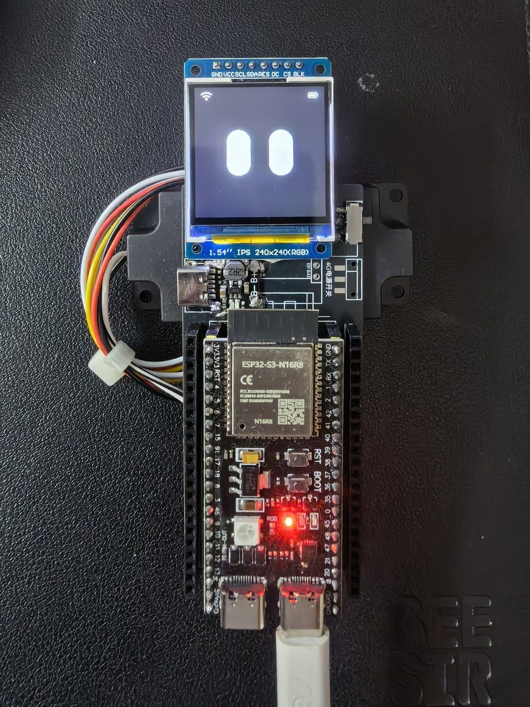
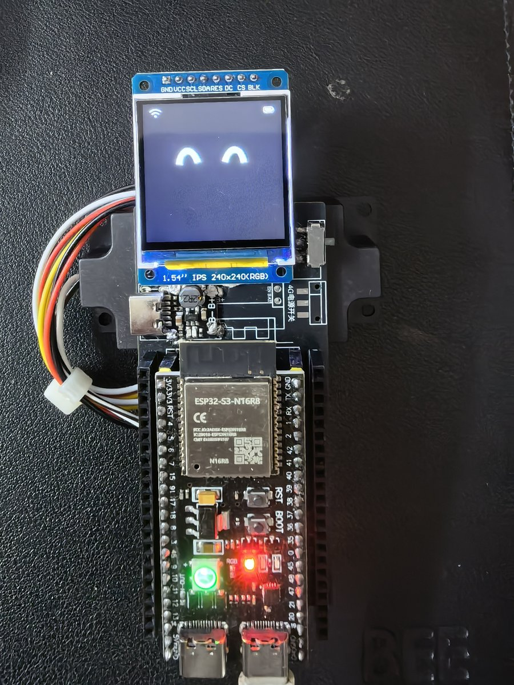
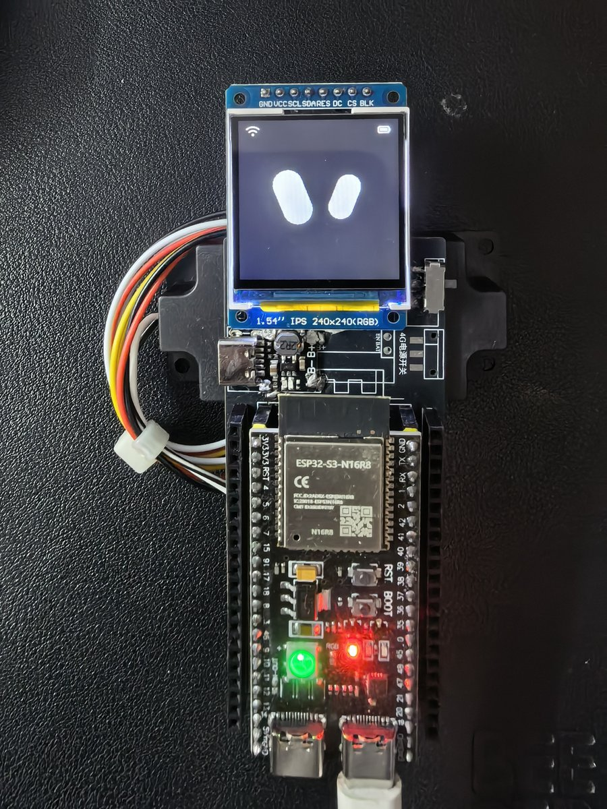
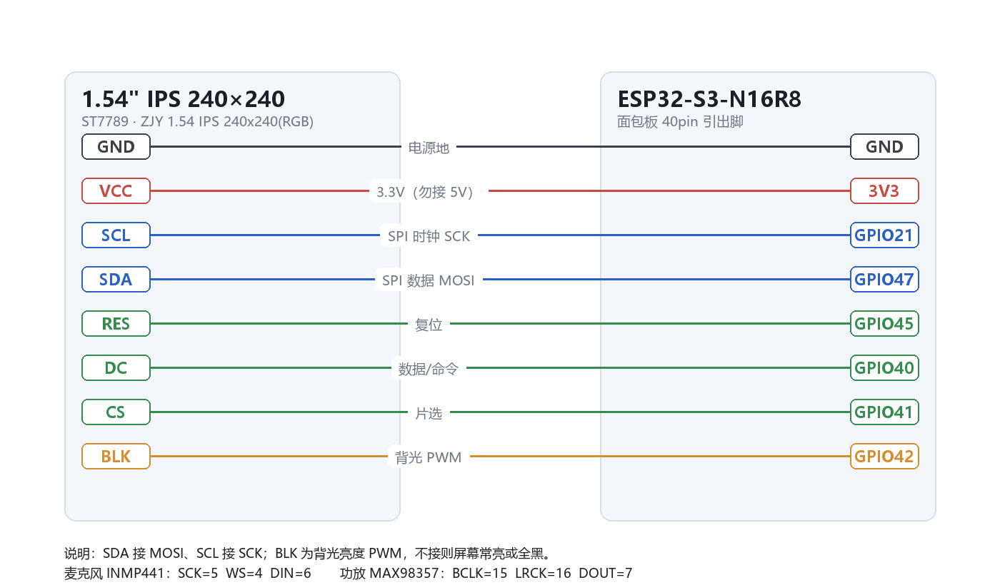
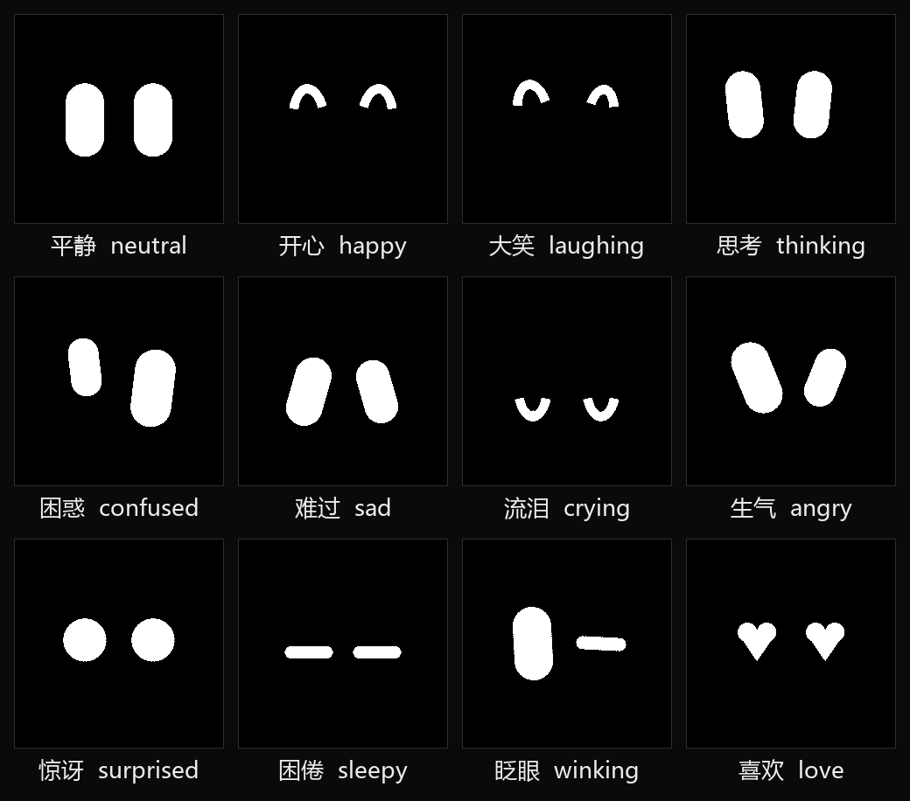

# xiaozhi-grok-eyes · Grok-style eyes firmware for XiaoZhi AI

[中文](README.md) | **English**

Turns the official `78/xiaozhi-esp32` (v2.2.6) into a desk toy with **nothing on screen but a pair of white eyes**:
pure black display, only two white eyes; still while silent, alive while speaking; expressions switch according to the emotion field sent by the server.

> One line: give XiaoZhi a Grok face.

**Don't want to build it yourself? Grab the [v1.0 prebuilt firmware](https://github.com/Ken-wang57220620/xiaozhi-grok-eyes/releases/latest), unzip, run `flash.bat`, done.**

Real device (idle / speaking / another emotion):

| Idle (neutral) | Speaking | Another emotion |
|---|---|---|
|  |  |  |

| UI mockup (self-drawn) | Screen wiring (self-drawn) |
|---|---|
|  |  |

12 expressions (below is the static first frame of each GIF; the playable originals live in `docs/emoji/`):



| neutral | happy | laughing | thinking |
|---|---|---|---|
|  |  |  |  |
| **confused** | **sad** | **crying** | **angry** |
|  |  |  |  |
| **surprised** | **sleepy** | **winking** | **love** |
|  |  |  |  |

- Target hardware: **ESP32-S3-N16R8 + 1.54" ST7789 240×240 SPI square LCD**, board SKU `bread-compact-wifi-lcd`
- Firmware version: app **2.2.6**
- Verified on real hardware: WiFi, wake word, conversation, all 12 expressions, animation only while speaking

> ⚠️ Read the "Notes" section below before flashing, especially **flash offsets** and **first flash must be the full set**.

---

## 1. What this firmware does

| Feature | Details |
|---|---|
| Pure black + white eyes | Theme layer forced to pure black; status bar text, subtitles, clock, mute icon all hidden |
| 12 expressions | neutral / happy / laughing / thinking / confused / sad / crying / angry / surprised / sleepy / winking / love |
| Animate only while speaking | GIF `Resume` on TTS start, `Pause` on TTS end; rests on the first frame |
| Expression follows content | The `emotion` field of each server `llm` message drives `SetEmotion`; unknown values fall back to neutral |
| Top icons | White WiFi icon top-left, battery slot top-right (this board has no fuel gauge, see "Known limitations") |
| Upstream emotion names | `aliases.json` maps 11 upstream aliases (confident / delicious / funny / kissy / shocked …) onto the 12 core expressions |

---

## 2. Notes (important)

### 2.1 Hardware must match, otherwise you get a black screen

| Item | Requirement |
|---|---|
| MCU | ESP32-S3 with **16 MB flash + 8 MB PSRAM** (N16R8) |
| Display | ST7789, **240×240**, SPI, 1.54 inch |
| Partition table | Must use the `partition-table.bin` from this package (v2/16m: ota_0 at 0x20000, assets at 0x800000) |
| Microphone | INMP441 (I2S, SCK=5 / WS=4 / DIN=6) |
| Amplifier | MAX98357 (I2S, BCLK=15 / LRCK=16 / DOUT=7) |

Display pins (hard-coded in `main/boards/bread-compact-wifi-lcd/config.h`; other wiring requires code changes and a rebuild):

```
MOSI=47  CLK=21  DC=40  RST=45  CS=41  BLK=42
LED=48   BOOT=0  LAMP=18
```

> If you have a 240×320 rectangular panel or a GC9A01 round one, **do not flash this firmware** — the image will be cropped or garbled.

### 2.2 The first flash must write all 5 files

Writing only `xiaozhi.bin` to the app partition leaves no assets partition, so every expression fails to load (`Emoji not found` on the serial log). Offsets must be exact:

```
0x0        bootloader.bin
0x8000     partition-table.bin
0xd000     ota_data_initial.bin
0x20000    xiaozhi.bin
0x800000   generated_assets.bin
```

On Windows just run `flash.bat` (edit `set PORT=COM3` to your port first). Linux/macOS: `./flash.sh /dev/ttyUSB0`.

### 2.3 Flashing wipes provisioning data

Once `otadata` is reset the device returns to first-time provisioning. With this minimal firmware the provisioning prompt is hidden, so **a black screen is normal** — connect to its hotspot from your phone to finish setup, then go through activation again.

If you are only **upgrading the app** (assets untouched), you can flash just `0x20000` and keep WiFi settings and activation status:

```
python -m esptool -p COM3 -b 921600 write_flash 0x20000 firmware/xiaozhi.bin
```

### 2.4 Re-activation is required after flashing

The firmware talks to the official server `https://api.tenclass.net` (`CONFIG_OTA_URL`). After boot, enter the 6-digit code announced by the device in the XiaoZhi console/app to bind it. **It cannot talk offline right out of the box.**

To use your own server, change `CONFIG_OTA_URL` in `sdkconfig` and rebuild.

### 2.5 Build environment (only needed if you modify code)

Upstream is v2.2.6 (tag `49ac8a6`) and needs **ESP-IDF 5.5.4** (5.4.x fails: `78/esp-ml307` and `uart-eth-modem` require idf ≥ 5.5.2). Three pitfalls that will bite you:

- **The project path must be pure ASCII.** A path like `D:\ESP32_项目\...` makes `xtensa objdump` fail with `Illegal byte sequence` and ccache crash outright.
- **Always pass `--no-ccache`**, same reason.
- **Set `IDF_PYTHON_ENV_PATH` explicitly**, otherwise `export.bat` picks the default py3.11 venv and `idf.py` fails on a missing `click`.

Working command (adjust paths):

```bat
cmd /c "set IDF_TOOLS_PATH=D:\ESP-32\PATH&& set IDF_PYTHON_ENV_PATH=D:\ESP-32\PATH\python_env\idf5.5_py3.13_env&& set IDF_GITHUB_ASSETS=dl.espressif.cn/github_assets&& call D:\ESP-32\v5.5.4\esp-idf\export.bat >nul 2>&1 && cd /d D:\ESP32_idf\xiaozhi-226 && idf.py --no-ccache build"
```

Toolchain downloads from GitHub often time out; `IDF_GITHUB_ASSETS=dl.espressif.cn/github_assets` switches to the Espressif mirror.

### 2.6 How to apply the source changes (prefer fork over copy-paste)

1. `git clone https://github.com/78/xiaozhi-esp32.git && git checkout 49ac8a6`
2. `git apply patches/grok-eyes.patch` (full diff of the 9 modified files)
3. Copy `main/assets/emoji/grok-eyes/` (12 GIFs + `aliases.json`) to the same path in the project
4. Build with the command above

### 2.7 Replacing the expression assets

- Must be **240×240 GIFs, pure black background, pure white shapes** — do not use transparency (on a black panel a transparent GIF composites to grey and is practically invisible).
- Drop them into `main/assets/emoji/grok-eyes/`; the filename is the expression name (`neutral.gif`, `happy.gif`, …).
- Names the server also sends (e.g. `shocked`) must be listed in `aliases.json`, otherwise that face never appears.
- Frame delays are hand-written into the GIF GCE blocks; do not re-save with a tool that "fixes" timing, or delays end up tripled.

### 2.8 Known limitations (not bugs)

- **No real battery level.** This board's IP5306 is only used as a power bank and its I2C is not routed to the MCU: scanning all SDA/SCL combinations across 13 free GPIOs gets no response from 0x75. So `GetBatteryLevel` returns false and **no battery icon is drawn** (better blank than a fake number).
  Want a real reading? Two options: ① feed the battery `+B` through a 100k/100k divider into an ADC pin and switch to `AdcBatteryMonitor`; ② if IP5306 SDA/SCL are broken out on your board, tell me the pins and I will add them to the candidate table in `ProbeIp5306()`.
- **Low-battery popup suppressed**: in minimal mode `low_battery_popup_` is force-hidden so it cannot break the black screen.
- **No subtitles, no clock, no mute icon**: deliberate design, not unfinished work.
- **Only this one board SKU**: `SetEyesOnly(true)` lives in the `bread-compact-wifi-lcd` constructor; other boards still build the stock UI.

---

## 3. Repository layout

```
.
├── README.md                  ← Chinese
├── README.en.md               ← this file
├── LICENSE                    ← upstream MIT text, must be kept
├── flash.bat                  ← one-click flash (Windows)
├── flash.sh                   ← one-click flash (Linux/macOS)
├── firmware/
│   ├── bootloader.bin         (16,256 B)
│   ├── partition-table.bin    (3,072 B)
│   ├── ota_data_initial.bin   (8,192 B)
│   ├── xiaozhi.bin            (2,805,440 B)  ← app
│   └── generated_assets.bin   (1,534,572 B)  ← 12 expressions
├── patches/
│   └── grok-eyes.patch        ← full diff of 9 source files
└── assets/
    └── emoji/grok-eyes/       ← 12 GIFs + aliases.json (copy into the project to rebuild)
```

---

## 4. Troubleshooting

| Symptom | Cause / fix |
|---|---|
| Fully black, no serial log at all | Wrong flash size or board; confirm a 16 MB N16R8 and re-flash the bootloader |
| White band at the top, eyes pushed down | Built from a 240×320 variant; this package pins `DISPLAY_HEIGHT` to 240 |
| No expressions at all, log says `Emoji not found` | Assets were not flashed to `0x800000`, or only the app was flashed |
| Eyes never move | They only move during TTS playback; holding the frame while silent is intended |
| Eyes look grey / washed out | Assets use a transparent background; use pure-black GIFs instead |
| `Could not open COM3` | Port changed or cable loose; re-check with `Get-CimInstance Win32_PnPEntity \| ? {$_.Name -match 'COM'}` |
| Build error `Illegal byte sequence` | Non-ASCII characters in the project path; move to an ASCII path |
| `idf.py` complains about missing `click` | `IDF_PYTHON_ENV_PATH` was not set |

---

## 5. Privacy

This package contains **no personal information**:

- No WiFi SSID / password (joined networks live in device NVS, and NVS is never committed)
- No device MAC, UUID or activation code
- No API keys or account data
- `sdkconfig` is not shipped; the firmware only carries the upstream default server `api.tenclass.net`

---

## 6. License and third-party components

### 6.1 This project's code

Upstream `78/xiaozhi-esp32` is **MIT licensed** (Copyright (c) 2025 Shenzhen Xinzhi Future Technology Co., Ltd.).
The modifications here (the 9 files in `grok-eyes.patch`) and the 12 eye GIFs **are original work of this project**, also released under MIT.
Keep `LICENSE` and the copyright notice and you are free to use, modify, sell and redistribute.

### 6.2 Third-party assets bundled in `generated_assets.bin`

| File | Content | Licensing |
|---|---|---|
| `font_puhui_common_16_4.bin` | Alibaba PuHuiTi subset | Alibaba declares it free for commercial use; the font itself may not be sold standalone |
| `srmodels.bin` | ESP-SR wake-word model ("你好小智") | From Espressif ESP-SR, under the Espressif license, distributed together with upstream firmware |
| 12 `*.gif` + `index.json` | Expressions and config made for this project | MIT |

The bundle contains **no** upstream Twemoji assets and no third-party icon sets; every expression is original.

### 6.3 Trademarks and disclaimer

- "Grok" is a trademark of xAI. This is a **third-party, unofficial modification**, unaffiliated with and not endorsed by xAI or xAI Grok. The word `grok` in the repo name only describes the visual style and will be changed if the trademark owner asks.
- Rights in "小智" / "xiaozhi-esp32" belong to the original authors (78 / Shenzhen Xinzhi Future Technology).
- The eye shape (two white capsules) is a design style; this project copies no code or assets from other repositories. Visual inspiration came from the public project `ArvinYin1/grokbot-animation-anatomy` and was used as a concept reference only.

> To eliminate trademark risk entirely, renaming the repo to `xiaozhi-eyes-only` also works — identical functionality, just without the word "Grok" in search.

---

## 7. Credits

- `78/xiaozhi-esp32` — the XiaoZhi AI firmware itself
- `ArvinYin1/grokbot-animation-anatomy` — visual concept for the Grok eyes
- Espressif ESP-IDF / ESP-SR, Alibaba PuHuiTi
