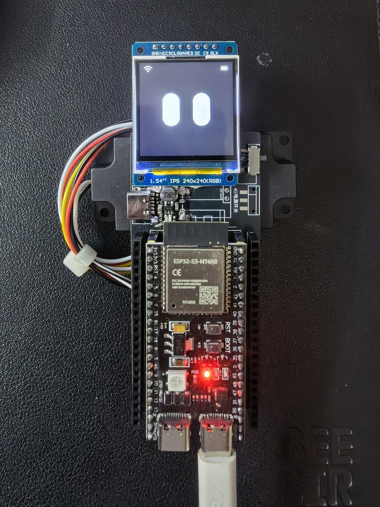
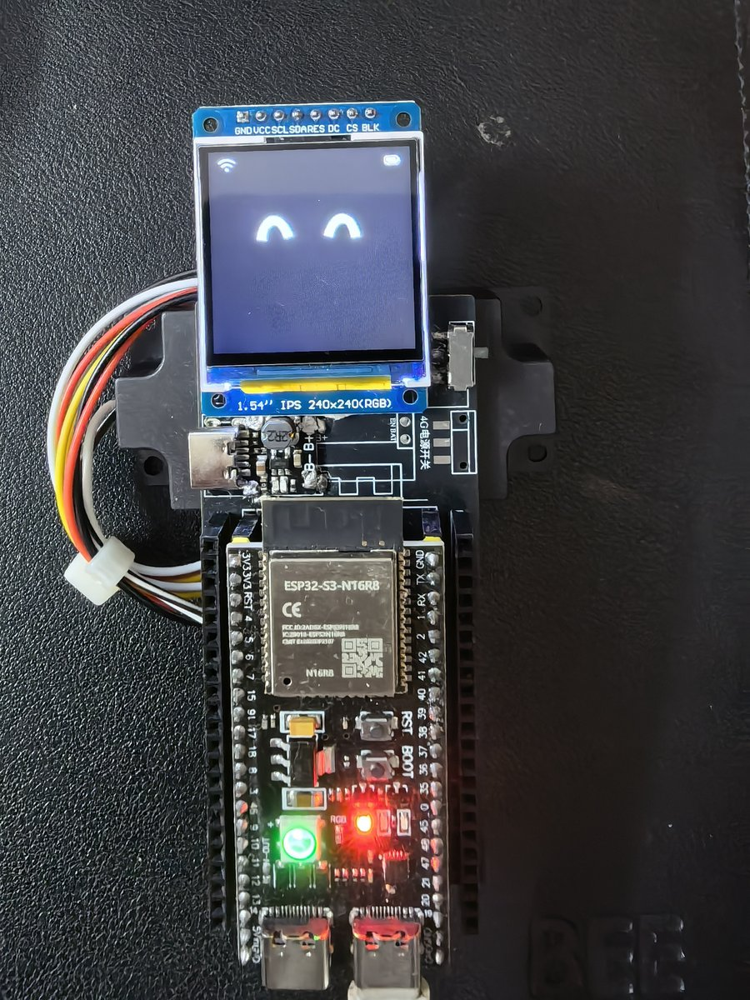
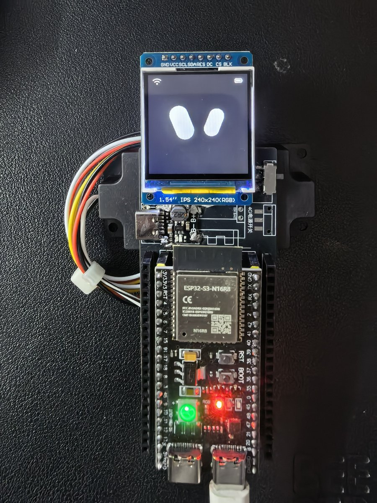
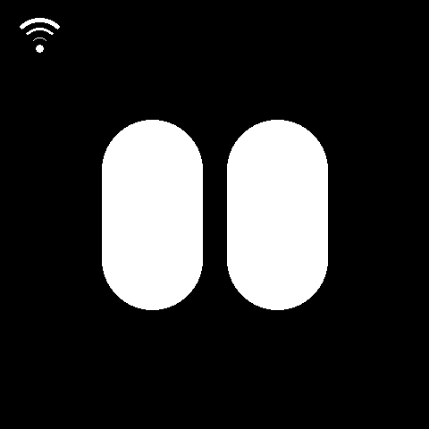
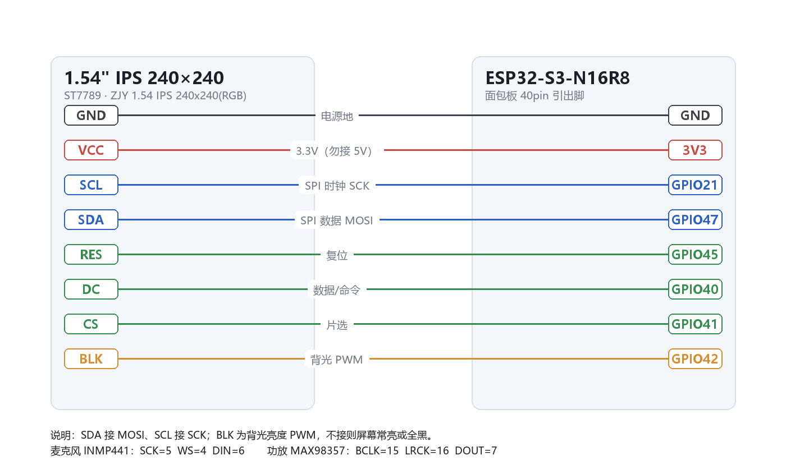
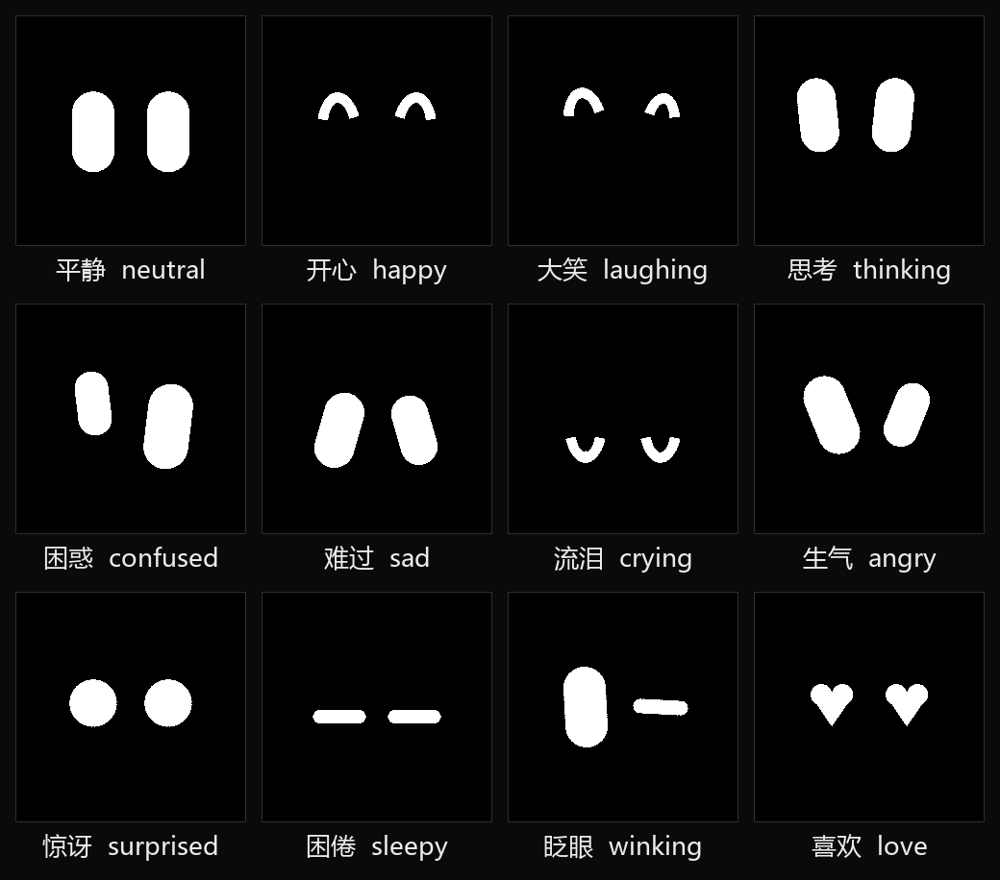

# xiaozhi-grok-eyes · 小智 AI 的 Grok 眼睛固件

**中文** | [English](README.en.md)

把官方 `78/xiaozhi-esp32`（v2.2.6）改造成 **Grok 风格「只有一双白眼睛」** 的桌面小摆件：
整屏纯黑，只有一对白色眼睛；不说话时静止，开口说话才动；根据服务端下发的情感切换表情。

> 一句话：给「小智」换一张 Grok 的脸。

**不想自己编译？直接下 [v1.0 预编译固件包](https://github.com/Ken-wang57220620/xiaozhi-grok-eyes/releases/latest)，解压后双击 `flash.bat` 即可刷机。**

实机效果（待机 / 说话中 / 情绪切换，实拍）：

| 待机（平静） | 说话中 | 其它情绪 |
|---|---|---|
|  |  |  |

| 界面示意（自绘） | 屏幕接线（自绘） |
|---|---|
|  |  |

12 套表情（下图是 GIF 首帧静态版，仓库里 `docs/emoji/` 放的是可播放的原始 GIF）：



| 平静 neutral | 开心 happy | 大笑 laughing | 思考 thinking |
|---|---|---|---|
|  |  |  |  |
| **困惑 confused** | **难过 sad** | **流泪 crying** | **生气 angry** |
|  |  |  |  |
| **惊讶 surprised** | **困倦 sleepy** | **眨眼 winking** | **喜欢 love** |
|  |  |  |  |

- 适配硬件：**ESP32-S3-N16R8 + 1.54" ST7789 240×240 方屏**，板型 SKU `bread-compact-wifi-lcd`
- 固件版本：App **2.2.6**
- 已实测：WiFi 连接、语音唤醒「你好小智」、对话、12 套表情切换、说话才动

> ⚠️ 下面的「注意事项」请务必先看完再刷机，尤其是**烧写偏移**和**首次必须刷全套**这两条。

---

## 一、这套固件做了什么

| 功能 | 说明 |
|---|---|
| 纯黑屏 + 白眼 | 主题层被强制覆盖为纯黑，状态栏文字、字幕、时间、静音图标全部隐藏 |
| 12 套表情 | neutral / happy / laughing / thinking / confused / sad / crying / angry / surprised / sleepy / winking / love |
| 只在说话时动 | TTS 开始时 GIF `Resume`，TTS 结束时 `Pause`，静止停在该表情首帧 |
| 按内容换表情 | 服务端每条 `llm` 消息里的 `emotion` 字段驱动 `SetEmotion`，映射不到的一律回落 neutral |
| 顶部图标 | 左上白色 WiFi 图标，右上白色电量位（本机无电量计，见「已知限制」） |
| 兼容原厂表情名 | `aliases.json` 把 confident/delicious/funny/kissy/shocked 等 11 个别名映射到 12 套本体 |

---

## 二、注意事项（重点）

### 1. 硬件必须对得上，否则刷完黑屏

| 项目 | 要求 |
|---|---|
| 主控 | ESP32-S3，**16 MB Flash + 8 MB PSRAM**（N16R8） |
| 屏幕 | ST7789，**240×240**，SPI 接口，1.54 吋 |
| 分区表 | 必须用本包的 `partition-table.bin`（v2/16m：ota_0 在 0x20000、assets 在 0x800000） |
| 麦克风 | INMP441（I2S，SCK=5 / WS=4 / DIN=6） |
| 功放 | MAX98357（I2S，BCLK=15 / LRCK=16 / DOUT=7） |

屏幕引脚（写死在 `main/boards/bread-compact-wifi-lcd/config.h`，接线不同必须改代码重编）：

```
MOSI=47  CLK=21  DC=40  RST=45  CS=41  BLK=42
LED=48   BOOT=0  LAMP=18
```

> 如果你买的是 240×320 长条屏、或 GC9A01 圆屏，**不要刷这套固件**，画面会被裁切或花屏。

### 2. 首次刷机必须刷「全套 5 个文件」

只刷 `xiaozhi.bin` 到 app 分区，会因为没有 assets 分区导致表情一个都加载不出来（串口会刷 `Emoji not found`）。偏移不能错：

```
0x0        bootloader.bin
0x8000     partition-table.bin
0xd000     ota_data_initial.bin
0x20000    xiaozhi.bin
0x800000   generated_assets.bin
```

Windows 直接双击 `flash.bat`（先把里面的 `set PORT=COM3` 改成你自己的端口）；Linux/macOS 用 `./flash.sh /dev/ttyUSB0`。

### 3. 刷机会清掉配网信息

`otadata` 被重置后设备回到首次配网状态：屏幕上会出现配网提示（这套极简固件里提示被隐藏，**看起来还是黑屏属正常**），需要用手机连它的热点完成配网。之后重新走一遍激活流程。

如果你只是**升级 app**（不动 assets），可以只刷 `0x20000`，这样 WiFi 配置和激活状态都保留：

```
python -m esptool -p COM3 -b 921600 write_flash 0x20000 firmware/xiaozhi.bin
```

### 4. 刷完要重新激活

固件连的是官方服务端 `https://api.tenclass.net`（`CONFIG_OTA_URL`），开机后需要在「小智」控制台/小程序里输入设备广播的 6 位验证码完成绑定。**不是刷完就能离线说话。**

想接自建服务端，改 `sdkconfig` 里的 `CONFIG_OTA_URL` 后重新编译。

### 5. 编译环境（想自己改代码才需要）

原工程是 v2.2.6（tag `49ac8a6`），依赖 **ESP-IDF 5.5.4**（5.4.x 编不过：`78/esp-ml307` 与 `uart-eth-modem` 硬要求 idf ≥ 5.5.2）。三个必踩的坑：

- **工程路径必须全英文**。`D:\ESP32_项目\...` 这种中文路径会让 `xtensa objdump` 报 `Illegal byte sequence`、ccache 直接崩。
- **必须 `--no-ccache`**，原因同上。
- **必须显式指定 `IDF_PYTHON_ENV_PATH`**，否则 `export.bat` 找的是默认 py3.11 venv，跑 `idf.py` 会缺 `click`。

可用命令（按自己的路径改）：

```bat
cmd /c "set IDF_TOOLS_PATH=D:\ESP-32\PATH&& set IDF_PYTHON_ENV_PATH=D:\ESP-32\PATH\python_env\idf5.5_py3.13_env&& set IDF_GITHUB_ASSETS=dl.espressif.cn/github_assets&& call D:\ESP-32\v5.5.4\esp-idf\export.bat >nul 2>&1 && cd /d D:\ESP32_idf\xiaozhi-226 && idf.py --no-ccache build"
```

工具链下载走 GitHub 常常超时，`IDF_GITHUB_ASSETS=dl.espressif.cn/github_assets` 这行就是切到国内镜像。

### 6. 改源码的方式（推荐 fork 而不是贴文件）

1. `git clone https://github.com/78/xiaozhi-esp32.git && git checkout 49ac8a6`
2. `git apply patches/grok-eyes.patch`（本包内 9 个文件的完整 diff）
3. 把 `main/assets/emoji/grok-eyes/`（12 支 GIF + `aliases.json`）整个拷进工程同路径
4. 按上一节命令编译

### 7. 表情素材怎么替换

- 必须是 **240×240、GIF、纯黑底、纯白图形**，不要用透明底（透明底在纯黑屏上叠出来是灰的，实测几乎看不见）。
- 放 `main/assets/emoji/grok-eyes/`，文件名就是表情名（`neutral.gif`、`happy.gif`…）。
- 服务端还认的名（如 `shocked`）写进 `aliases.json` 做映射，否则那张脸不会出现。
- 帧延时是手写进 GIF 的 GCE 块里的，不要用会「自动修正」的工具二次保存，容易把延时写翻倍。

### 8. 已知限制（别当 bug 报）

- **没有真实电量**。这块板子的 IP5306 只当充电宝用，I2C 没有引到 MCU：开机扫遍 13 个空闲 GPIO 的所有 SDA/SCL 组合都收不到 0x75 应答。所以 `GetBatteryLevel` 直接返回 false，右上角**不显示电池图标**（宁可空着也不给假数字）。
  想要真实电量，两条路：① 电池 `+B` 经 100k/100k 分压到某个 ADC 脚，改用 `AdcBatteryMonitor`；② IP5306 的 SDA/SCL 若已引出，告诉我引脚，代码里 `ProbeIp5306()` 的候选表加进去即可。
- **低电弹窗被屏蔽**：极简模式下 `low_battery_popup_` 强制隐藏，避免破坏纯黑画面。
- **没有字幕、没有时间、没有静音图标**：这是设计取舍，不是没做完。
- **只在这一个板型生效**：`SetEyesOnly(true)` 写在 `bread-compact-wifi-lcd` 的构造函数里，别的板型编出来还是原版 UI。

---

## 三、目录结构

```
.
├── README.md                  ← 本文件
├── LICENSE                    ← 上游 MIT 原文，必须保留
├── flash.bat                  ← Windows 一键烧写
├── flash.sh                   ← Linux/macOS 一键烧写
├── firmware/
│   ├── bootloader.bin         (16,256 B)
│   ├── partition-table.bin    (3,072 B)
│   ├── ota_data_initial.bin   (8,192 B)
│   ├── xiaozhi.bin            (2,805,440 B)  ← app
│   └── generated_assets.bin   (1,534,572 B)  ← 12 套表情
├── patches/
│   └── grok-eyes.patch        ← 9 个源文件的完整 diff
└── assets/
    └── emoji/grok-eyes/       ← 12 支 GIF + aliases.json（重编时拷进工程）
```

---

## 四、故障排查

| 现象 | 原因 / 处理 |
|---|---|
| 刷完全黑，连串口都没有日志 | Flash 大小或板型不对；确认是 16 MB 的 N16R8，并重刷 bootloader |
| 屏幕顶部一条白带、眼睛偏下 | 用了 240×320 的分支编译；本包已把 `DISPLAY_HEIGHT` 固定成 240 |
| 表情全都不显示，日志 `Emoji not found` | assets 没刷到 `0x800000`，或只刷了 app |
| 表情不动 | 只有 TTS 播放期间才动；不出声时刻意保持停帧，属于预期行为 |
| 眼睛是灰的、发白 | 素材用了透明底；改用纯黑底 GIF |
| `Could not open COM3` | 端口号变了或线松了，用 `Get-CimInstance Win32_PnPEntity \| ? {$_.Name -match 'COM'}` 重新确认 |
| 编译报 `Illegal byte sequence` | 工程路径里有中文，换纯英文路径 |
| `idf.py` 报缺 `click` | 没指定 `IDF_PYTHON_ENV_PATH` |

---

## 五、隐私说明

本包**不包含**任何个人信息：

- 没有 WiFi SSID / 密码（连过的网络存在设备 NVS 里，NVS 不会被提交）
- 没有设备 MAC、UUID、激活码
- 没有任何 API Key 或账号信息
- `sdkconfig` 未打包；固件里只有上游默认的服务端地址 `api.tenclass.net`

---

## 六、许可与第三方组件

### 1. 本项目的代码

上游 `78/xiaozhi-esp32` 为 **MIT License**（Copyright (c) 2025 Shenzhen Xinzhi Future Technology Co., Ltd.）。
本改造的代码（`grok-eyes.patch` 里的 9 个文件）与 12 支眼睛 GIF **为本项目自制**，同样以 MIT 发布。
保留 `LICENSE` 与版权声明即可自由使用、修改、商用、再分发。

### 2. 固件里打包的第三方资源（`generated_assets.bin`）

| 文件 | 内容 | 授权情况 |
|---|---|---|
| `font_puhui_common_16_4.bin` | 阿里巴巴普惠体子集 | 阿里普惠体官方声明免费商用，不可单独售卖字体 |
| `srmodels.bin` | ESP-SR 唤醒词模型（「你好小智」） | 来自 Espressif ESP-SR，受 Espressif 许可约束，随上游固件一起分发 |
| 12 支 `*.gif` + `index.json` | 本项目自制表情与配置 | MIT |

包里**没有**原厂 Twemoji 表情、也没有任何第三方图标素材，表情全部为自制。

### 3. 商标与免责

- 「Grok」是 xAI 的商标。本项目是**第三方非官方改造**，与 xAI、xAI Grok 无任何关联、未获其背书。仓库名里使用 `grok` 只为描述视觉风格，如收到商标方要求会改名。
- 「小智」「xiaozhi-esp32」相关权益归原作者（78 / 深圳新智未来科技）所有。
- 眼睛造型（两个白色胶囊）属于设计风格，本项目未复制任何第三方仓库的代码或素材；视觉灵感来自公开项目 `ArvinYin1/grokbot-animation-anatomy`，仅作思路参考。

> 若你希望彻底规避商标风险，把仓库改名为 `xiaozhi-eyes-only` 也完全可行，功能一致，只是搜索时少了「Grok」这个词。

---

## 七、致谢

- `78/xiaozhi-esp32`：小智 AI 固件本体
- `ArvinYin1/grokbot-animation-anatomy`：Grok 眼睛引擎的视觉思路
- Espressif ESP-IDF / ESP-SR、阿里巴巴普惠体

